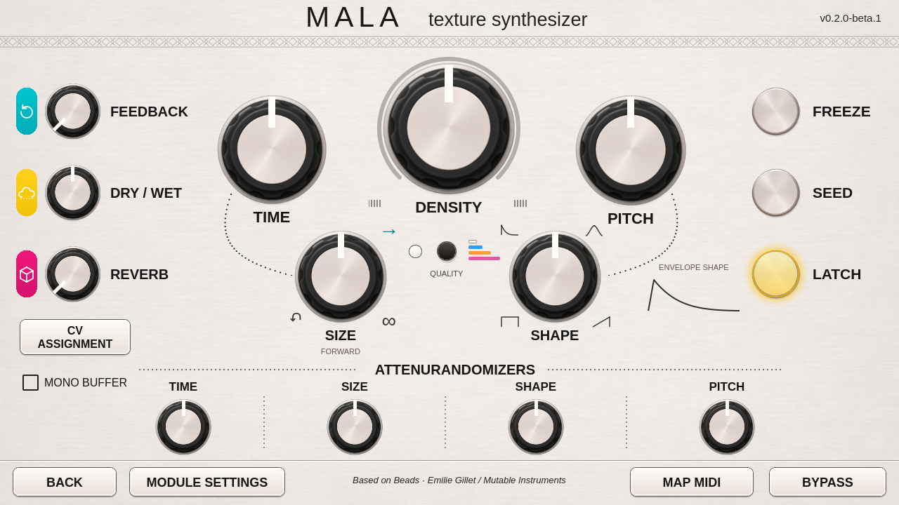

# Mala - Texture Synthesizer (Beads) for Poly Hector

Mala is a granular texture processor for **Poly Effects Hector running firmware 407**. It captures audio in a buffer and plays it back in tiny slices called grains. Use it to stretch a sound into a texture, scatter grains across a patch, or freeze a moment and keep playing it.

**[Download the current beta · Mala v2](https://github.com/jahmontee/mala-module/releases/tag/v0.2.0-beta.1)** · [All releases](https://github.com/jahmontee/mala-module/releases)

## What it does

- **Shape grains.** Control their pitch, size, density, and envelope, with four recording qualities and a wavetable mode.
- **Freeze and Seed.** Hold the audio buffer, trigger grains by hand, or latch Seed for sustained triggering.
- **Patch it into Hector.** Modulate parameters with CV, map controls to MIDI, and save frozen buffers with presets.
- **Play from the touchscreen.** The v2 editor adds vertical knob gestures and a Shape guide that follows the envelope control.

## Install and use

The release page includes the USB installer, matching rollback kit, and checksums. The v2 USB kits have passed computer testing. A physical Hector USB trial is pending. [USB install guide](https://github.com/jahmontee/mala-module/blob/v0.2.0-beta.1/docs/USB-INSTALL.md) · [Compatibility and rollback](https://github.com/jahmontee/mala-module/blob/v0.2.0-beta.1/docs/COMPATIBILITY.md)

## Source and credits

The default branch contains the beta.6 source. Each release has version-specific source and instructions. [Mala v2 source and README](https://github.com/jahmontee/mala-module/tree/v0.2.0-beta.1) · [Original beta.6 release](https://github.com/jahmontee/mala-module/releases/tag/v0.1.0-beta.6)

Mala is an independent community adaptation of **Beads** by **Emilie Gillet / Mutable Instruments**. The Hector adaptation is by **jahmontee / Poly Hector**, with AI development assistance from OpenAI Codex. [Credits and licenses](https://github.com/jahmontee/mala-module/blob/main/CREDITS.md) · [Report an issue](https://github.com/jahmontee/mala-module/issues)
