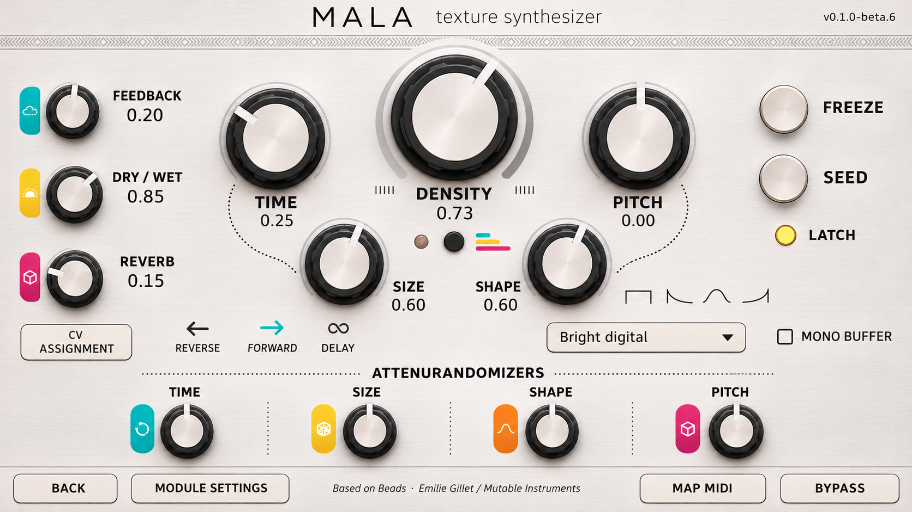
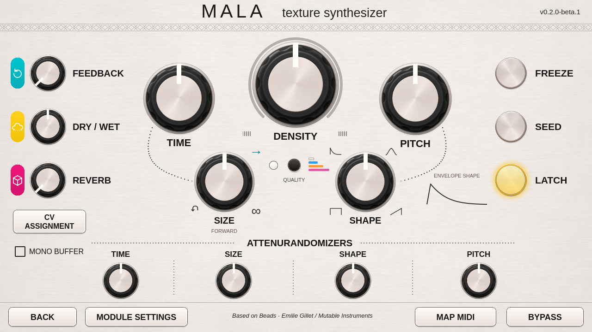

# Mala v2 artwork rebuild

The approved concept is the visual reference for this revision. The earlier
plain-circle preview has been replaced by textured silver, sculpted black knobs,
brushed metal caps, colored symbol badges, larger typography, dotted guides and
the original arrangement of the lower controls and footer.

Approved concept (an AI-generated illustration):

Implemented interface (an actual Qt5 render):

## How the artwork works

The panel, knob body and silver pushbutton face are reusable PNG assets in
`ui/qml/mala/assets/`. The built-in image-generation tool created these assets
using the approved concept as a reference. The final prompts, purposes, file
sizes and SHA-256 hashes are recorded in [the artwork manifest](../ui-artwork.json).
The source images are retained unchanged. Their transparent margins are handled
by QML layout; no external image editor or paid API workflow is required.

The software adds and rotates a separate pointer over each stationary knob body,
so the lighting remains fixed as values change. The badge symbols, engraved
border, dotted routing lines and envelope curves are drawn in QML. Labels,
readouts, recording-quality selection and buttons remain real controls.
Feedback now uses the counterclockwise circular-arrow symbol, while Dry/Wet
uses the cloud symbol. The printed quality key has all four colors, white
above blue, orange and pink.

Shared source images are cached. Decode sizes are bounded to the display needs;
this is not a full-screen picture with invisible controls placed over it.

The twelve knobs retain Echo Field's vertical gesture: 160 pixels per complete
range, one-percent panel steps, a single wheel step per event, and double-tap to
minimum. Mala's existing native Beads response conversion is unchanged. The numerical
readouts and four lower colored badges are temporarily hidden for visual review.
Their display components, bound values and gestures remain intact and can be
restored using the editor appearance switches.

The black button below Density now opens the [four-mode quality menu](V2-QUALITY.md).
The LED on its left follows the actual processing quality: white, blue, orange
or pink. The former lower dropdown has been removed.

Size and Shape now use hardware-style rim markings and below-knob labels, with
a continuous envelope-shape guide. Freeze and Seed have yellow face illumination
and halos. See [panel-control details](V2-PANEL-CONTROLS.md).

The original whole-patch CPU reading is available at the top of Module Settings.
The footer keeps Back, Module Settings, the original DSP credit, Map MIDI and
Bypass. The v0.2.0-beta.1 label identifies the release candidate. The version printed
on the original illustrative concept is historical.

## Validation and release boundary

The real Qt5 components are rendered at 1280×720 and exercised with two numeric
host fixtures. The checks cover all twelve knobs, parameter readback and native
response, seventeen MIDI targets, Freeze acknowledgement, Seed's real four-second
hold timer, quality selection, mono buffer, CV/settings/help dialogs, Back and
Bypass. The CPU reading is checked in its new settings location.

All three exact image assets are included in the v2 catalog and both kits carry
complete source/provenance. The accepted sound engine, URI and ports are retained.
Private v2 device use and current computer-only public USB checks are separate
evidence. See VALIDATION.md and COMPATIBILITY.md for exact scope.
