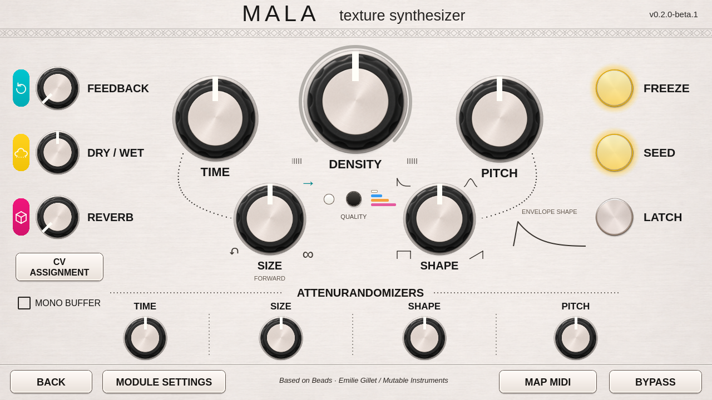

# Size, Shape and yellow button illumination

Size and Shape now follow the hardware-panel arrangement: names and values sit
below the knobs, with function symbols around their rims. Their actual control
positions and Echo Field drag behavior are unchanged.

## Size markings

The reverse arrow marks the left region, the forward arrow the middle/right
region, and infinity the delay endpoint. The caption below Size follows the
manual panel value. In wavetable synthesis it reads **Grain Duration**, because
the printed reverse and delay marks do not select those functions in that mode.

**Forward** means normal-direction grain playback for the Size knob's base
setting. The caption is a readout of that region; turning Size can change it to
Reverse or the Delay endpoint. It is not a separate playback button.

These are panel guides, not a report of every modulated grain. The existing DSP
uses a reverse boundary near one third and enters delay near the far-right end,
with its original transition time and hysteresis. CV and randomness can affect
individual grains. No new mode-switching logic has been added to the DSP.

Source: [grain duration](../vendor/beads/dsp/granular_player.h) and
[delay transition](../vendor/beads/dsp/processor.cc).

## Shape markings and preview

The four printed contours follow the pointer sweep: square at the lower left,
decay at the upper left, bell at the upper right and a rising envelope at the
lower right. The larger drawing beside Shape follows the current manual Shape
value continuously instead of choosing one of four fixed pictures.

`EnvelopeGraphic.qml` uses the same normalized attack, sustain, release and
curvature relationships as the vendored
[Beads grain envelope](../vendor/beads/dsp/grain_envelope.h). The canonical shapes
occur at 0, one third, two thirds and 1. The decay uses the original fourth-power
curve; the bell blends toward smoothstep; the rising endpoint has a linear rise.

The drawing is an envelope-shape guide. It normalizes duration and omits the
engine's minimum attack/release timing and per-grain CV/randomness. It does not
measure a currently sounding grain or record audio. It repaints when Shape
changes, with no new polling or animation timer.

## Freeze and Seed

Both round button faces now illuminate yellow, with a warm halo and gold rim.
The original silver texture remains visible through the face tint.

- Freeze stays lit while `active_freeze` reports a hold, including an external
  Freeze gate. After a tap it follows engine acknowledgement.
- Seed lights during a momentary press. A latched Seed is indicated by the separate Latch lamp. Its existing
  four-second hold and Seed/Freeze gesture use the unchanged bridge.
- Latch keeps its separate yellow indication. Press feedback is immediate;
  persistent lighting follows the corresponding control state.

The halo uses stationary translucent rings and the face uses a tint over the
cached image. No blur shader, audio work or animation loop is added.

## Checks

The real Qt5 fixture checks label placement, Size captions including synthesis,
the four envelope landmarks and distinct rendered curves, Freeze's acknowledged
and external holds, momentary/latched/held Seed, and yellow face pixels in the
actual screenshot. Existing knob, quality-menu, MIDI and footer checks are kept.

The v2 UI was privately deployed and visually approved on Hector. Current
public USB checks use simulated hardware. Exact-kit physical touch/audio, real
MIDI/CV and broad saved-buffer recall remain unqualified. Read VALIDATION.md.
