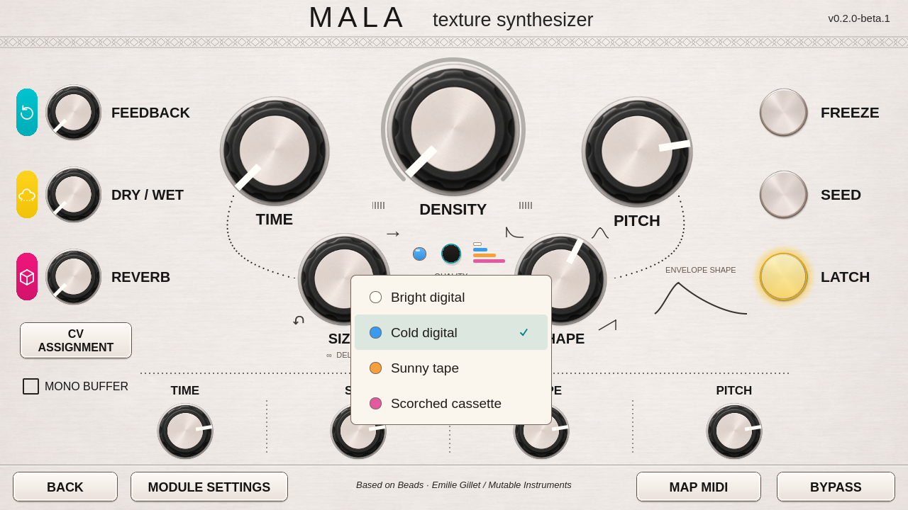

# Center quality selector

Press the small black button directly below Density to open the four recording
qualities. Each menu row has a colored swatch and the selected choice has a tick.
The previous large dropdown below Shape has been removed.

| LED | Quality |
|---|---|
| White | Bright digital |
| Blue | Cold digital |
| Orange | Sunny tape |
| Pink | Scorched cassette |

The printed color stack beside the button follows the same order from top to
bottom: white, blue, orange, pink. White has a fine outline so it stays visible
against the silver panel.

The round LED to the left of the button follows the sound engine's
`active_quality` report. The menu selection follows the requested `quality`
parameter. Choosing a mode while the buffer is frozen keeps the LED on the mode
still in use and shows the new mode as queued. The LED changes when the engine
reports that it has applied the new mode; a request or Freeze release alone does
not prematurely change the indication. Existing DSP behavior is unchanged.

Host and MIDI updates also update the selection and LED. In Map MIDI mode,
pressing this same center button selects the existing quality parameter for
mapping without opening the menu or changing the quality. Tapping outside the
open menu dismisses it without pressing the control underneath.

The real Qt5 fixture checks all four choices and LED colors, active-state
acknowledgement, queued changes while frozen, host updates, MIDI mapping and
outside-tap dismissal. The existing knob and footer checks still apply. This is
an experimental candidate with computer-only public USB checks. The UI was
privately deployed on Hector. Exact-kit physical testing remains unperformed.
Read VALIDATION.md and COMPATIBILITY.md.
