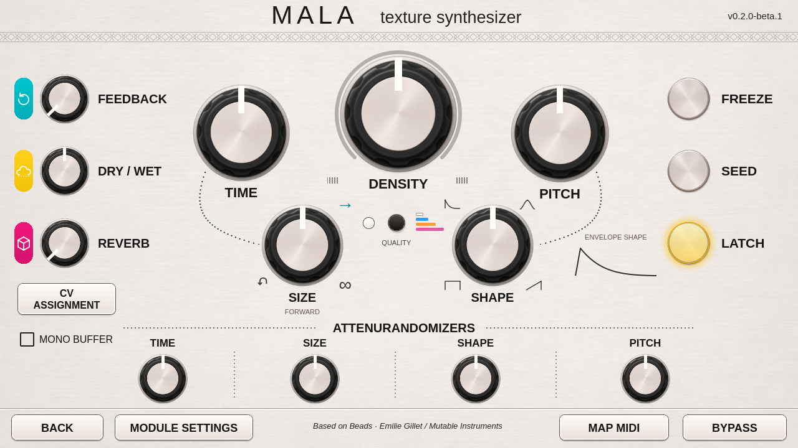

# Mala v2 interface

This experimental source contains the approved v2 interface, privately deployed
and visually approved on Hector. Public USB testing is computer-only. Read
VALIDATION.md and COMPATIBILITY.md for exact scope.



## Interface

The cream/silver panel groups Density above Time, Pitch, Size and Shape. Feedback,
Dry/Wet and Reverb have their own knobs. Size and Shape have markings around
the knobs and labels underneath, with a live normalized Shape envelope guide.
Freeze illuminates yellow when active; Seed lights during a press, with a separate Latch indication for the held state. See [panel controls](V2-PANEL-CONTROLS.md).
The center quality button opens its four-mode menu, with a white/blue/orange/pink
LED for the active mode. Latch, mono buffer and CV Assignment remain on the
same page. The four lower colored badges and all main knob numerical readouts are
temporarily hidden for visual review. The controls and parameter values remain
intact, including MIDI mapping and the envelope drawing. Back stays left of Module Settings; Bypass stays at the far
right. The existing whole-patch CPU reading is retained in Module Settings to match
the approved footer layout.

The rebuilt interface uses textured panel and knob artwork, with separate QML
pointer rotation and working controls. The approved concept is reproduced much
more closely in this revision; see [artwork details and reference](V2-ARTWORK.md). No new audio processing, polling timer,
network connection or hardware access is added by this interface.

The three left-side labels are centered beside their knobs. Mono Buffer sits
beneath CV Assignment. The lower
Size and Shape knobs and titles are centered between the dotted dividers, and
the main Size region caption sits five pixels below its title. Latch still holds
Seed active in the engine; the independent lights clarify press versus latch.

The two appearance switches `showLowerBadges` and `showKnobValues` in
`Editor.qml` are currently false. Setting either back to true restores that
part of the display without changing parameters. Numeric touch popups and hover
tooltips stay hidden along with the numerical readouts. The three mix-control
badges and the four quality-color stripes remain visible.

## Knob movement

The interaction follows the approved Mala knob interaction:

- Drag straight up to increase and down to decrease.
- A 160-pixel vertical drag covers the full panel range.
- Touching a knob does not jump its value to the contact point.
- Horizontal motion does not adjust the knob.
- Movement uses one-percent panel-position steps; one mouse-wheel event moves
  one step, using the same one-percent increment.
- Double-click/double-tap resets to the minimum, with the approved gesture. For Pitch this
  means the lowest pitch setting, not center; for attenurandomizers it means the
  negative endpoint. This gesture is suppressed during MIDI selection.

Mala's existing Beads response lookup still converts panel position into actual
pitch and modulation values. The DSP, LV2 URI, 58 ports, LV2 metadata defaults
and saved-state format are unchanged. Existing patches are intended to keep the same sound and
values. Actual Hector patch recall and touch feel still need hands-on validation.

Map MIDI selects the existing firmware parameter page without changing a value.
Freeze shows the active engine state, and Bypass waits for the host's acknowledged
state. Momentary Seed, its four-second hold, and Latch use the existing Seed/latch bridge behavior.

## New-module knob defaults

New Mala instances start with Feedback and Reverb fully counterclockwise. Dry/Wet,
Time, Density, Pitch, Size, Shape and all four attenurandomizers start at noon.
This is a one-time initialization after Add Module, using the existing fresh-add
hook. Opening an editor, rediscovering a module or loading a saved patch does not
reset its values. Existing LV2 metadata fallback defaults are retained.

At noon, Pitch is zero semitones and the attenurandomizers are neutral. Density
at noon pauses automatic grain generation; Seed can trigger a grain, or Density
can be turned away from center to start a grain stream. Latch's existing default
is unchanged.

Freeze, Seed and Latch share a 67-pixel face diameter and a 200-by-76 touch area.
Their centers align with Feedback, Dry/Wet and Reverb at 116-pixel intervals.

## Computer-only checks

Use Python 3.10 with PySide2 5.15.2.1 for the computer checks, or an equivalent Qt5
development environment. The libraries are development-computer dependencies;
no runtime or system-library upgrade is proposed for Hector.

Build the native test library, then run:

```sh
python3 tools/build.py
python3 -m unittest discover -s tests -v
python3 tools/audit.py
# With the Qt5 development runtime:
python3 -m unittest discover -s tests -p test_fresh_defaults.py -v
QT_QPA_PLATFORM=offscreen QT_QPA_PLATFORMTHEME= QT_STYLE_OVERRIDE=Fusion QT_QUICK_BACKEND=software python3 tools/qt_check.py --v2 --output build/v2-qt-check
```

The UI checker loads the real editor and bridge with two numeric host fixtures
and the native Beads knob lookup. It checks all twelve knobs, bounds, readback,
external updates, Freeze acknowledgement, momentary/held Seed, Latch, quality,
mono, dialogs, MIDI targets and the unchanged footer behavior. Its screenshots
are actual rendered QML. It neither creates audio instances nor opens a device.

The public kit uses the coordinated revision2 catalog and explicit beta.6
update path. Read COMPATIBILITY.md, VALIDATION.md and USB-INSTALL.md. Earlier
published beta.6 downloads remain separate historical assets.
